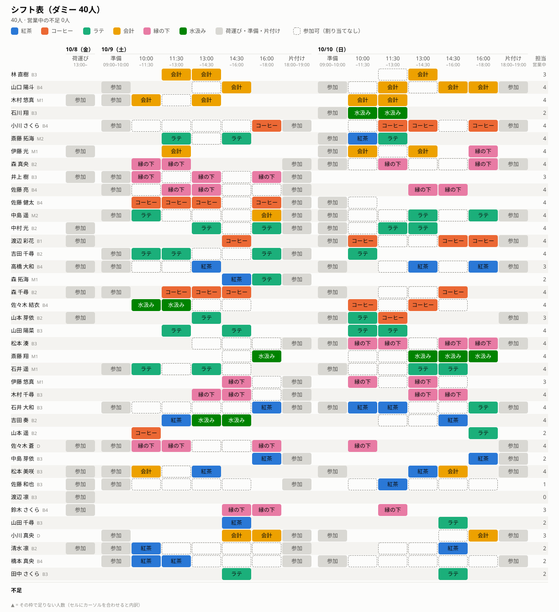

# SchedOpt

[English](README.md) | 日本語

大学祭カフェの当日シフトを、整数線形計画問題（ILP）として定式化し、数理最適化によって解く。

## 動機

カフェのシフトを手で組むのは難しい。メンバーごとに参加できる時間帯が違い、営業中の枠ごとに役割別の必要人数が決まっている。
役割によっては一人で担当できる人が必要で、メンバーには希望の役割もある。さらに、負担は公平にしたいし、連続して入る枠数も抑えたい。

これは **ナース・スケジューリング問題（nurse scheduling problem, NSP）**、別名 **ナース・ロスタリング問題（nurse rostering problem, NRP）** の一種である。
NSP は、必要人数・勤務可能な時間帯・勤務規則を満たしつつ、できるだけ希望に沿うようにスタッフを勤務枠へ割り当てる問題である [1, 2]。
NSP は一般に NP 困難であり [3]、あらゆる入力に対して最適なシフトを効率よく求めるアルゴリズムは知られていない。
そのため、手作業や単純な規則で組んだシフトでは、より良いシフトや、すべての条件を満たすシフトを見落としやすい。

そこでこのプロジェクトでは、汎用の MIP ソルバーで最適なシフトを求める。
ソルバーは分枝限定法により、最適なシフトを「これより良いシフトはない」という証明付きで返す。このカフェの規模（メンバー数十人、営業中の枠が10程度）なら、数秒〜数分で解ける。
すべての条件を満たすことができない場合でも、モデルはシフトを返し、どこで人が足りないかを報告する。

## 用語

| 用語 | 意味 |
|---|---|
| **元データ** | Google フォームの回答。CSV でダウンロードしたもの |
| **処理データ** | 元データを整形した、イベントごとに1つの TSV。集計する人が手で編集する（習熟度の記入、修正） |
| **イベント定義** | `config/<イベント>/`。イベントの枠と役割。フォームはこれをもとに作る |

## ディレクトリ構成

```
config/<イベント>/          イベント定義。手で編集する（git 管理）
  slots.csv                 シフト枠。label がフォームの選択肢になる
  roles.csv                 役割。label がフォームの選択肢になる
data/
  *.csv                     元データ（個人情報を含むため git 管理外）
  processed/<イベント>.tsv  処理データ（氏名を含むため git 管理外）
  dummy/small.tsv           config/dummy 用のダミー処理データ 40人
  dummy/medium.tsv          config/dummy 用のダミー処理データ 60人
model/
  schedule.mod              最適化モデル（GNU MathProg）
scripts/
  check_processed.awk       処理データをイベント定義と突き合わせてチェック
  make_dat.awk              イベント定義と処理データからモデルのデータファイルを作る
  check_assignment.awk      解いた割り当てを処理データと突き合わせてチェック
  render_schedule.sh        解いたシフトを画像（SVG）にする（bash + gawk）
  generate_dummy.sh         ダミーデータ生成（bash + awk）
docs/                       README 用の画像（ダミーデータから作成）
out/                        データファイルと結果（氏名を含みうるため git 管理外）
```

最適化に渡すデータセットは `config/<イベント>/` ＋ `data/processed/<イベント>.tsv`（または `data/dummy/*.tsv`）。

## セットアップ

すべて Unix のシェルで動き、ビルドは要らない。Windows では WSL を使う。

| ツール | 用途 | |
|---|---|---|
| bash | `scripts/*.sh` | 必須 |
| GNU awk（`gawk`）4.0 以降 | すべての `.awk` スクリプト、元データの整形（`FPAT`）、シフト表の画像 | 必須 |
| GLPK（`glpsol`） | モデルを解く | 必須 |
| coreutils（`sort`, `cut`, `paste` など） | 元データの整形 | 必須（通常は最初から入っている） |
| util-linux の `column` | [処理データの表示](#処理データの表示)（`-o` は util-linux 版が必要） | 任意 |
| Google Chrome | シフト表の画像を PNG にする | 任意 |
| ほかの MIP ソルバー | [別のソルバー](#別のソルバー) | 任意 |

RHEL / AlmaLinux / Rocky Linux :

```sh
sudo dnf install epel-release
sudo dnf install gawk glpk-utils util-linux
```

Debian / Ubuntu :

```sh
sudo apt install gawk glpk-utils bsdextrautils
```

macOS（[Homebrew](https://brew.sh/) :

```sh
brew install gawk glpk util-linux
```

ダミーデータで動作を確認する:

```sh
gawk -f scripts/check_processed.awk config/dummy/roles.csv config/dummy/slots.csv data/dummy/small.tsv   # OK と出る
mkdir -p out
gawk -f scripts/make_dat.awk config/dummy/roles.csv config/dummy/slots.csv data/dummy/small.tsv > out/dummy.dat
glpsol -m model/schedule.mod -d out/dummy.dat --cuts
```

`glpsol` の最後に出る集計で `missing people` が 0 になり、`out/assignment.csv` が書き出されれば成功。
AlmaLinux 10（gawk 5.3、GLPK 5.0、bash 5.2）、Debian 13 / Ubuntu 24.04、macOS（gawk 5.4.1、GLPK 5.0、util-linux 2.42.4）で確認済み。

## 使い方の流れ

1. `config/<イベント>/` にイベントを定義する（[イベント定義](#イベント定義)）
2. その定義から Google フォームを作る（[フォームの作り方](#フォームの作り方)）
3. 回答を CSV でダウンロードして `data/` に置く
4. `data/processed/<イベント>.tsv` に整形する（[元データの整形](#元データの整形)）
5. 習熟度の記入や必要な修正を手で行い、チェックする（[処理データの編集](#処理データの編集)）
6. シフトを解く（[最適化](#最適化)）

## イベント定義

UTF-8・改行 LF の CSV。

### slots.csv

```
date,slot,kind,start,end,label
2026-10-09,loading,loading,13:00,,荷運び
2026-10-10,setup,setup,09:00,10:00,朝の準備
2026-10-10,s1,service,10:00,11:30,10:00~11:30
...
2026-10-10,s5,service,16:00,18:00,16:00~18:00
2026-10-10,cleanup,cleanup,18:00,19:00,片付け
2026-10-11,setup,setup,09:00,10:00,朝の準備
...
```

| 列 | 内容 |
|---|---|
| `date` | `YYYY-MM-DD`。日数はいくつでもよく、フォームには日付ごとに質問を1つ作る |
| `slot` | 枠のID。日付の中で一意、スペースを含めない。枠は (`date`, `slot`) で特定する |
| `kind` | `loading`（荷運び）, `setup`（営業開始前の準備）, `service`（営業中。役割ごとに人が必要）, `cleanup`（営業終了後の片付け）。`loading`・`setup`・`cleanup` の枠は、参加できると答えた人が全員入る |
| `start`, `end` | `HH:MM`。`setup` はその日の最初の `service` 枠の開始時刻に終わり、`cleanup` は最後の `service` 枠の終了時刻に始まる |
| `label` | フォームの選択肢の文言。日付の中で一意にし、`", "` を含めない |

### roles.csv

```
role,label,skill,need
tea,紅茶,1,2
coffee,コーヒー,1,2
latte,ラテ,1,3
cashier,会計,0,2
support,縁の下,0,3
water,水汲み,0,1
```

| 列 | 内容 |
|---|---|
| `role` | 役割のID。スペースと `=` を含めない |
| `label` | フォームの選択肢の文言（一意） |
| `skill` | 集計する人がメンバーの習熟度を付ける役割なら `1`、そうでなければ `0` |
| `need` | 営業中（`service`）の各枠で、その役割に必要な人数 |

## フォームの作り方

Google フォームを、次の質問タイトルそのままで作る。整形手順は質問タイトルで列を探すので、質問の順番は自由。

| 質問タイトル | 形式 | 選択肢 |
|---|---|---|
| `氏名` | 記述式 | |
| `学年` | プルダウン | `B1`, `B2`, `B3`, `B4`, `M1`, `M2`, `D` |
| `参加できますか` | ラジオボタン | `はい`, `いいえ` |
| `<M/D> 参加できる時間帯`（日付ごとに1つ。例: `10/10 参加できる時間帯`） | チェックボックス（必須にしない） | その日付の枠の `label`（ファイルの順） |
| `第1希望`, `第2希望`, `第3希望` | プルダウン | 全役割の `label` |
| `備考` | 段落 | （自由記述。整形時に捨てる） |

- **メールアドレスを収集する** をオンにする（1人1回答に絞るのに使う）。
- チェックボックスに「その他」は付けない。自由記述は `備考` に書いてもらう。
- ある日付のチェックがすべて空なら「その日は参加できない」とみなす。

## 処理データの形式

イベントごとに1つの TSV（UTF-8・改行 LF）。参加者（`参加できますか` が `はい` の人）1人につき1行。

```
member_id  name       grade  pref                    skill                   2027-10-08  2027-10-09      2027-10-10
M001       林 直樹    B3     cashier coffee support  tea=2 coffee=1 latte=2              s2 s3           s2 s3
M003       木村 悠真  M1     cashier support water   tea=1 coffee=2 latte=2  loading     setup s1 s2 s3  s1 s2
```

（`data/dummy/small.tsv` の行。実際の区切りはタブ。読みやすいように揃えて表示している）

| 列 | 内容 |
|---|---|
| `member_id` | 回答順に `M001`, `M002`, … |
| `name` | 回答された氏名 |
| `grade` | `B1`〜`B4`, `M1`, `M2`, `D` |
| `pref` | 希望する役割（`role` のID）をスペース区切りで、希望順に。空でもよい |
| `skill` | 集計する人が付ける習熟度。`role=レベル` をスペース区切りで。`skill=1` の役割だけ。書いていない役割はレベル 0。整形直後は空 |
| 日付ごとの列 | その日に参加できる枠の `slot` をスペース区切りで、`slots.csv` の順に。空なら参加不可 |

習熟度: `0` 未経験、`1` 補助ならできる、`2` 一人で担当できる、`3` 人に教えられる。

元データから捨てる項目：タイムスタンプ（重複判定にだけ使う）、メールアドレス、`参加できますか`、`備考`。
どの `label` にも当たらない自由記述は、警告を出して捨てる。

## 元データの整形

シェルで手作業で行う。以下は 2026 年の例。

```sh
RAW="data/2026技科大祭当日提供シフトメンバー募集（回答） - フォームの回答 1.csv"
CONF=config/2026
OUT=data/processed/2026.tsv
WORK=data/processed/2026.work          # 中間ファイル置き場
mkdir -p $WORK
DATES=$(tail -n +2 $CONF/slots.csv | cut -d, -f1 | sort -u | paste -sd' ')   # イベントの全日付
```

### 1. CSV → TSV（1回答＝1行）

ダウンロードした CSV には、改行コード CRLF、カンマを含む引用符付きの値（`"朝の準備, 10:00~11:30"`）、
自由記述の中の改行が含まれうる。gawk の `FPAT` で列を分け、引用符が閉じていない行は次の行とつなげる。

```sh
gawk -v FPAT='([^,]*)|("([^"]|"")*")' '
{ sub(/\r$/, "")
  buf = (buf == "" ? $0 : buf " " $0)
  if (gsub(/"/, "&", buf) % 2) next      # 引用符が閉じていない -> 次の行と結合
  $0 = buf; buf = ""
  for (i = 1; i <= NF; i++) {
    f = $i
    if (f ~ /^"/) { f = substr(f, 2, length(f) - 2); gsub(/""/, "\"", f) }
    gsub(/\t/, " ", f)
    printf "%s%s", f, (i < NF ? "\t" : "\n")
  } }' "$RAW" > $WORK/raw.tsv

awk -F'\t' '{ print NF }' $WORK/raw.tsv | sort | uniq -c   # 全行が同じ列数になっていることを確認
```

### 2. 質問タイトルで列を選び、重複回答を除いて参加者に絞る

```sh
awk -F'\t' -v OFS='\t' -v dates="$DATES" '
NR == 1 {                                   # ヘッダー: 質問タイトルから列を探す
  for (i = 1; i <= NF; i++) col[$i] = i
  split("タイムスタンプ メールアドレス 参加できますか 氏名 学年 第1希望 第2希望 第3希望", q, " ")
  for (k = 1; k <= 8; k++) q[k] = col[q[k]] ? col[q[k]] : err(q[k])
  n = split(dates, d, " ")
  for (k = 1; k <= n; k++) {                # 2026-10-10 -> "10/10 参加できる時間帯"
    split(d[k], ymd, "-"); title = (ymd[2] + 0) "/" (ymd[3] + 0) " 参加できる時間帯"
    day[k] = col[title] ? col[title] : err(title)
  }
  next }
function err(title) { print "question not found: " title > "/dev/stderr"; exit 1 }
{ split($q[1], t, /[\/ :]/)                 # 2026/09/02 7:59:48 -> 20260902075948（並べ替えできる形）
  printf "%04d%02d%02d%02d%02d%02d", t[1], t[2], t[3], t[4], t[5], t[6]
  printf "\t%s", tolower($q[2])
  for (k = 3; k <= 8; k++) printf "\t%s", $q[k]
  for (k = 1; k <= n; k++) printf "\t%s", $day[k]
  print "" }' $WORK/raw.tsv \
| sort -t$'\t' -k1,1r \
| sort -t$'\t' -s -u -k2,2 \
| awk -F'\t' '$3 == "はい"' \
| sort -t$'\t' -k1,1 \
| cut -f4- > $WORK/answers.tsv
```

- `sort -k1,1r` で新しい順に並べ、`sort -s -u -k2,2`（安定ソートで、メールアドレスが同じものの先頭＝最新だけを残す）で重複回答を除く
- 参加者への絞り込みは**重複除去の後**に行う（最新の回答が「いいえ」の人を、古い「はい」で残さないため）
- 最後に回答順に並べ直し、タイムスタンプ・メール・参加フラグを捨てる

`answers.tsv` の列: `氏名, 学年, 第1希望, 第2希望, 第3希望` と、`$DATES` の順に日付ごとの列。

### 3. 処理データを組み立てる

役割の文言は `roles.csv` で、枠の文言は `slots.csv` で (日付, 文言) を引いてIDに変換する。
知らない文言は警告を出して捨て、重複した希望は最初の1つだけ残す。

```sh
awk -F'\t' -v OFS='\t' -v dates="$DATES" '
BEGIN { n = split(dates, d, " ") }
FILENAME == ARGV[1] { if (FNR > 1) { split($0, a, ","); role[a[2]] = a[1] } next }     # roles.csv: label -> role
FILENAME == ARGV[2] { if (FNR > 1) { split($0, a, ","); slot[a[1], a[6]] = a[2]       # slots.csv: (date, label) -> slot
                                     order[a[1]] = order[a[1]] " " a[2] } next }
FNR == 1 { printf "member_id\tname\tgrade\tpref\tskill"; for (k = 1; k <= n; k++) printf "\t%s", d[k]; print "" }
{ id = sprintf("M%03d", FNR)
  name = $1; gsub(/^[ 　]+|[ 　]+$/, "", name)
  pref = ""; split("", used)
  for (i = 3; i <= 5; i++) {
    if ($i == "") continue
    if (!($i in role)) { print id ": unknown role: " $i > "/dev/stderr"; continue }
    r = role[$i]; if (!(r in used)) { used[r]; pref = pref (pref == "" ? "" : " ") r }
  }
  printf "%s\t%s\t%s\t%s\t", id, name, $2, pref       # skill は空のまま
  for (k = 1; k <= n; k++) {
    split("", chosen); m = split($(5 + k), v, /, /)
    for (j = 1; j <= m; j++)
      if ((d[k], v[j]) in slot) chosen[slot[d[k], v[j]]]
      else if (v[j] != "") print id ": unknown option on " d[k] ": " v[j] > "/dev/stderr"
    out = ""; c = split(order[d[k]], o, " ")            # slots.csv の順に書く
    for (j = 1; j <= c; j++) if (o[j] in chosen) out = out (out == "" ? "" : " ") o[j]
    printf "\t%s", out
  }
  print "" }' $CONF/roles.csv $CONF/slots.csv $WORK/answers.tsv > $WORK/new.tsv
```

### 4. 書き出す（記入済みの習熟度は引き継ぐ）

`$OUT` がすでにある場合（回答が増えて整形し直すとき）、`member_id` が変わりうるので、習熟度は氏名で引き継ぐ。
それ以外の手での修正は引き継がないので、フォームを締め切ってから行う。

```sh
touch $OUT
awk -F'\t' -v OFS='\t' '
FILENAME == ARGV[1] { if (FNR > 1 && $5 != "") skill[$2] = $5; next }
FNR > 1 && $5 == "" && ($2 in skill) { $5 = skill[$2]; delete skill[$2] }
{ print }
END { for (s in skill) print "skill not carried over (name not found): " s > "/dev/stderr" }' \
  $OUT $WORK/new.tsv > $WORK/merged.tsv && mv $WORK/merged.tsv $OUT

gawk -f scripts/check_processed.awk $CONF/roles.csv $CONF/slots.csv $OUT
```

### 5. 後片付け

中間ファイルにはメールアドレスと自由記述が残っているので、確認が済んだら消す。

```sh
rm $WORK/raw.tsv $WORK/answers.tsv $WORK/new.tsv && rmdir $WORK
```

### AI エージェントに任せる場合

整形は、このリポジトリでシェルのコマンドを実行できる AI コーディングエージェント（Claude Code など）に任せてもよい。
元データには氏名やメールアドレスが含まれるので、所属組織が個人情報の扱いを認めている AI ツールだけを使うこと。

プロンプト例:

```
Google フォームの回答（元データ）を、README.ja.md の「元データの整形」の手順どおりに処理データにしてください。

- 元データ: data/<ファイル名>.csv
- イベント定義: config/2027/
- 出力: data/processed/2027.tsv

守ってほしいこと:
- 手順のコマンドをそのまま使い、独自の処理を足さない。手順で対応できないことがあれば、作業を止めて相談する
- 最後に scripts/check_processed.awk でチェックし、結果を報告する
- 警告（unknown role / unknown option / skill not carried over）は一覧にして報告する。
  自由記述の内容を勝手に解釈してデータに反映しない
- 氏名・メールアドレスなどの個人情報は、報告に必要な範囲を超えて出力しない
- 私が結果を確認したら、手順5で中間ファイルを削除する
```

## 処理データの表示

ファイルはただの TSV なので、エディタでは列が揃わない。表示するときは `column` で揃える
（空欄も全角文字も正しく扱える。ファイルは変更しない）。

```sh
column -t -s $'\t' data/processed/2026.tsv
column -t -s $'\t' -o ' │ ' data/processed/2026.tsv | less -S     # 区切り線付き、横スクロール
```

エイリアスにしておくと便利: `alias tsv="column -t -s $'\t' -o ' │ '"` として `tsv data/processed/2026.tsv`。

## 処理データの編集

`data/processed/<イベント>.tsv` をエディタか表計算ソフトで開いて、直接編集する。
エディタの機能（CSV 拡張機能の「整列」コマンドなど）でセルにスペースを詰めて列を揃えた場合は、処理する前に元に戻す。
下のチェックで、スペースが詰められたセルを報告する。

- 習熟度: `skill` 列に `role=レベル` を書く。例: `tea=2 latte=3`
- 参加できる枠: 日付の列の `slot` を足したり消したりする（「前日と同じく」のように捨てられた回答の反映など）

編集したらチェックする。

```sh
gawk -f scripts/check_processed.awk config/2026/roles.csv config/2026/slots.csv data/processed/2026.tsv
```

知らない学年・役割・枠、0〜3 以外の習熟度、列数の誤り、ID の重複、スペースが詰められたセルを報告する。

## 最適化

### モデル

`model/schedule.mod`（GNU MathProg）は、営業中の枠でメンバーを役割に割り当てる。
荷運び・準備・片付けの枠は参加できると答えた人が全員入るので、最適化の対象にしない。

| 記号 | 意味 |
|---|---|
| $M$, $R$, $R^{skill} \subseteq R$ | メンバー、役割、習熟度を付ける役割 |
| $S^{svc}$ | `service` の枠 |
| $A$ | メンバー $m$ がフォームで枠 $t$ に参加できると答えた組 $(m, t)$ |
| $A^{svc}$ | $A$ のうち $t \in S^{svc}$ の組 |
| $n_r$ | 営業中の枠で役割ごとに必要な人数（`roles.csv`） |
| $p_{mr}$ | 希望の点数（`pref_score`）: 第1／第2／第3希望なら 3／2／1、それ以外は 0 |
| $\ell_{mr}$ | 習熟度（0〜3）。$r \in R^{skill}$ のみ。書かれていなければ 0 |
| $\lambda$ | 「一人で担当できる」とみなす習熟度（`lead_level`、既定値 2） |
| $k_r$ | 営業中の枠で役割 $r \in R^{skill}$ を一人で担当できる人の必要人数（`lead_need`、既定値 1。$n_r$ 以下であること） |
| $a_m$ | メンバー $m$ が参加できると答えた営業中の枠の数 |
| $L$ | 1人あたりの最低担当枠数（`min_load`、既定値 1） |
| $K$ | 連続して入れる枠数の上限（`max_consecutive`、既定値 3） |

変数:

- $x_{mtr} \in \{0,1\}$（$(m, t) \in A^{svc}$, $r \in R$）: $m$ が営業中の枠 $t$ で役割 $r$ に入る
- $u_{tr} \ge 0$（$t \in S^{svc}$, $r \in R$）: 不足人数
- $v_{tr} \ge 0$（$t \in S^{svc}$, $r \in R^{skill}$）: 一人で担当できる人の不足人数
- $z \ge 0$: 一番多く入る人の営業中の枠数
- $y_m \ge 0$（$a_m > 0$ の人だけ）: メンバー $m$ の営業中の担当枠数が $\min(L, a_m)$ に足りない数

$x$ は $(m, t) \in A^{svc}$ の組にしか作らないので、**フォームで答えた時間帯以外に割り当てられることはない**。
$u$, $v$, $y$, $z$ は連続変数。$x$ が 0/1 で $n_r$, $k_r$, $L$ が整数なので、$u$ は常に整数になり、$v$, $y$, $z$ は重みが正ならどの最適解でも整数になる。

和の中で $t$ は $S^{svc}$ を動く。ただし $m$ が決まっている和では $(m, t) \in A^{svc}$ となる $t$ だけを動く。$m$ は $(m, t) \in A$ となるメンバーを動く。

$$
\min\ w^{short} \sum_{t,r} u_{tr} + w^{lead} \sum_{t,\ r \in R^{skill}} v_{tr} - w^{pref} \sum_{m,t,r} p_{mr}\, x_{mtr} + w^{fair}\, z + w^{under} \sum_m y_m
$$

| 重み | パラメータ | 既定値 | 単位 |
|---|---|---|---|
| $w^{short}$ | `w_short` | 1000 | 不足1人あたり |
| $w^{lead}$ | `w_lead` | 100 | 一人で担当できる人の不足1人あたり |
| $w^{pref}$ | `w_pref` | 1 | 希望の点数1点あたり |
| $w^{fair}$ | `w_fair` | 10 | 一番多く入る人の営業中の枠1つあたり |
| $w^{under}$ | `w_under` | 50 | `min_load` に足りない枠1つあたり |

重みは 0 以上とする。

| 制約 | |
|---|---|
| $\sum_r x_{mtr} \le 1 \quad ((m, t) \in A^{svc})$ | 同じ枠では役割は1つ |
| $\sum_m x_{mtr} + u_{tr} = n_r \quad (t \in S^{svc},\ r \in R)$ | 営業中の枠の役割ごとの人数 |
| $\sum_{m:\ \ell_{mr} \ge \lambda} x_{mtr} + v_{tr} \ge k_r \quad (t \in S^{svc},\ r \in R^{skill})$ | 一人で担当できる人を最低 $k_r$ 人 |
| $\sum_{t,r} x_{mtr} \le z \quad (m \in M)$ | 全員の営業中の担当枠数は $z$ 以下 |
| $\sum_{t,r} x_{mtr} + y_m \ge \min(L, a_m) \quad (a_m > 0)$ | 営業中の枠に参加できると答えた人は、最低 $\min(L, a_m)$ 枠入る（守れない場合は足りない枠ごとにペナルティ） |
| 各メンバー $m$ と、営業中の枠を含む連続 $K+1$ 枠のどの並び $W$ でも $\sum_{t \in W} b_{mt} \le K$ | 連続して入れるのは $K$ 枠まで |

最後の行の $b_{mt}$ はメンバー $m$ が枠 $t$ に入るかどうかで、本人が参加できると答えた営業中の枠なら $\sum_r x_{mtr}$、荷運び・準備・片付けの枠なら 1（その枠には入るため）、答えていない枠なら 0。
「連続」は、同じ日付で `slots.csv` の並びが隣り合っている枠のこと。
営業中の枠を含まない並びは対象外: その和はモデルで変えられない定数で、$K$ を超えるとモデルが解を持たなくなるため。

人の不足は大きなコストを付けて許すので、モデルは必ず解を持ち、どこが足りないかを報告する。
担当枠数が `min_load` に届かない人が出ることも許す（席より人が多いと避けられない）。
既定の重みでは、通常は「人の不足」「一人で担当できる人の不足」「`min_load` に届かない人」「希望・偏り」の順に優先される。
この順は重みの比によるもので、厳密には保証されない。たとえば `w_lead` は `w_under` のちょうど2倍なので、一人で担当できる人の不足1人と `min_load` に届かない人2人は同じコストになる。
順位を厳密にしたいときは重みの差を広げる（例: `w_lead` を `w_under` の2倍より大きくする）。
重み（`w_short`, `w_lead`, `w_pref`, `w_fair`, `w_under`）、希望の点数（`pref_score`）、「一人で担当できる」とみなすレベル（`lead_level`）、
その人数（`lead_need`）、連続して入れる枠数（`max_consecutive`）、1人あたりの最低担当枠数（`min_load`）は既定値付きのパラメータで、別のデータファイルで上書きできる。

```
data;
param w_fair := 30;
param lead_need := latte 2;
param max_consecutive := 2;
end;
```

### 実行

```sh
mkdir -p out
gawk -f scripts/make_dat.awk config/2026/roles.csv config/2026/slots.csv data/processed/2026.tsv > out/2026.dat
glpsol -m model/schedule.mod -d out/2026.dat --cuts     # パラメータを上書きするときは  -d weights.dat  を足す
gawk -v max_consecutive=3 -f scripts/check_assignment.awk config/2026/slots.csv data/processed/2026.tsv out/assignment.csv
```

`--cuts` は GLPK の切除平面を有効にする。付けないと、データによっては最適解はすぐ見つかるのに、最適であることの証明に何分もかかる。
`glpsol` は枠ごとの割り当てとサマリー（不足人数、一番多く入る人の枠数、担当0の人数、希望の当たり方）を表示し、
`out/assignment.csv`（`member_id,name,date,slot,role`。荷運び・準備・片付けでは `role` は空）を書き出す。
`check_assignment.awk` で、すべての割り当てが本人の答えた枠に収まっていること、同じ枠に二重に入っていないこと、
`max_consecutive`（モデルと同じ値を渡す）を超えて連続していないことを確かめる。一番長い連続の枠数も表示する。

### シフト表の画像

結果を画像にする。メンバーごとに1行、枠ごとに1列で、セルに役割を書く。

```sh
scripts/render_schedule.sh --config config/2026 --processed data/processed/2026.tsv \
  --assignment out/assignment.csv -o out/schedule.svg --title "シフト表 2026"
```

`out/schedule.svg` をブラウザで開く（セルにカーソルを合わせると詳細が出る）。PNG が必要なら Chrome でスクリーンショットを撮る。
サイズは SVG の `width` / `height` に書いてある。

```sh
google-chrome --headless=new --hide-scrollbars --window-size=1224,1338 \
  --screenshot=out/schedule.png "file://$PWD/out/schedule.svg"
```

`data/dummy/small.tsv` で作った例:



セル: 役割（色と役割名）・荷運び／準備／片付けは `参加`・点線の枠は参加可だが割り当てなし・空欄は参加不可。
右端の列は各メンバーの営業中の担当枠数、最下段の ▲ はその枠で足りない人数。

### 別のソルバー

別の MIP ソルバー（HiGHS, SCIP, CPLEX, Gurobi など）を使うときは、モデルを LP 形式で書き出してそのソルバーに渡す。

```sh
glpsol -m model/schedule.mod -d out/2026.dat --check --wlp out/2026.lp
```

## ダミーデータ

`scripts/generate_dummy.sh` は、任意のイベント定義に対して処理データを作る（bash と awk だけで動く）。
日付・枠・役割は config から読む。

```sh
scripts/generate_dummy.sh --config config/dummy -o data/dummy/small.tsv -n 40  --seed 0
scripts/generate_dummy.sh --config config/dummy -o data/dummy/medium.tsv -n 60 --seed 1
```

営業中の席数（営業中の枠数 × 1枠に必要な人数）と、営業中の枠に参加できる人数を表示する。
人数が席数を超えると警告を出す（担当0の人が避けられず、計算も遅くなる）。

スクリプトと awk の実装が同じなら、同じコマンド・同じ `--seed` で同じデータが再び得られる。
上のコマンドは `data/dummy/` のファイルの作り方を示すもので、今のスクリプトで生成した結果と一致するとは限らない
（作成後にスクリプトが変わったり、ファイルが編集されたりしうる）。現時点では `data/dummy/small.tsv` は一致しない。

氏名はよくある姓と名をランダムに組み合わせたもの。

日付ごとに、次のように参加できる枠を決める。

- `loading` の枠: それぞれ 45% の確率で参加可
- その日の全枠（18%）、参加不可（12%）、または連続した `service` 枠のブロック（ときどき途中が1枠抜ける）。
  最初の営業枠から入るブロックは `setup` を、最後の営業枠まで残るブロックは `cleanup` を含みやすい

前の日付と枠の種類が同じ日付は、35% の確率で前の日と同じパターンにする。

習熟度は `skill=1` のすべての役割について生成する。学年が上ほど高く、第1希望の役割は1段階上がりやすい。

## 集計の例

```sh
F=data/dummy/small.tsv

# ロング形式: (メンバー, 日付, 枠) ごとに1行
awk -F'\t' -v OFS='\t' 'NR == 1 { for (i = 6; i <= NF; i++) h[i] = $i; next }
  { for (i = 6; i <= NF; i++) { m = split($i, v, " "); for (j = 1; j <= m; j++) print $1, h[i], v[j] } }' $F > long.tsv

# 枠ごとの参加可能人数
cut -f2,3 long.tsv | sort | uniq -c

# 1人あたりの参加可能枠数の分布（何枠出られる人が何人いるか）
cut -f1 long.tsv | uniq -c | awk '{ print $1 }' | sort -n | uniq -c

# 第1希望の内訳
tail -n +2 $F | cut -f4 | cut -d' ' -f1 | sort | uniq -c | sort -rn

# 一人でラテを担当できる人（レベル2以上）
awk -F'\t' 'NR > 1 && $5 ~ /(^| )latte=[23]/ { print $1, $2, $5 }' $F
```

## 参考文献

1. Wikipedia, "Nurse scheduling problem" （2026年8月16日版）. <https://en.wikipedia.org/w/index.php?title=Nurse_scheduling_problem&oldid=1369652809>
2. E. K. Burke, P. De Causmaecker, G. Vanden Berghe, H. Van Landeghem. The state of the art of nurse rostering. *Journal of Scheduling* 7(6): 441–499, 2004. [doi:10.1023/B:JOSH.0000046076.75950.0b](https://doi.org/10.1023/B:JOSH.0000046076.75950.0b)
3. T. Osogami, H. Imai. Classification of various neighborhood operations for the nurse scheduling problem. In *Algorithms and Computation (ISAAC 2000)*, LNCS 1969, pp. 72–83, Springer, 2000. [doi:10.1007/3-540-40996-3_7](https://doi.org/10.1007/3-540-40996-3_7)
