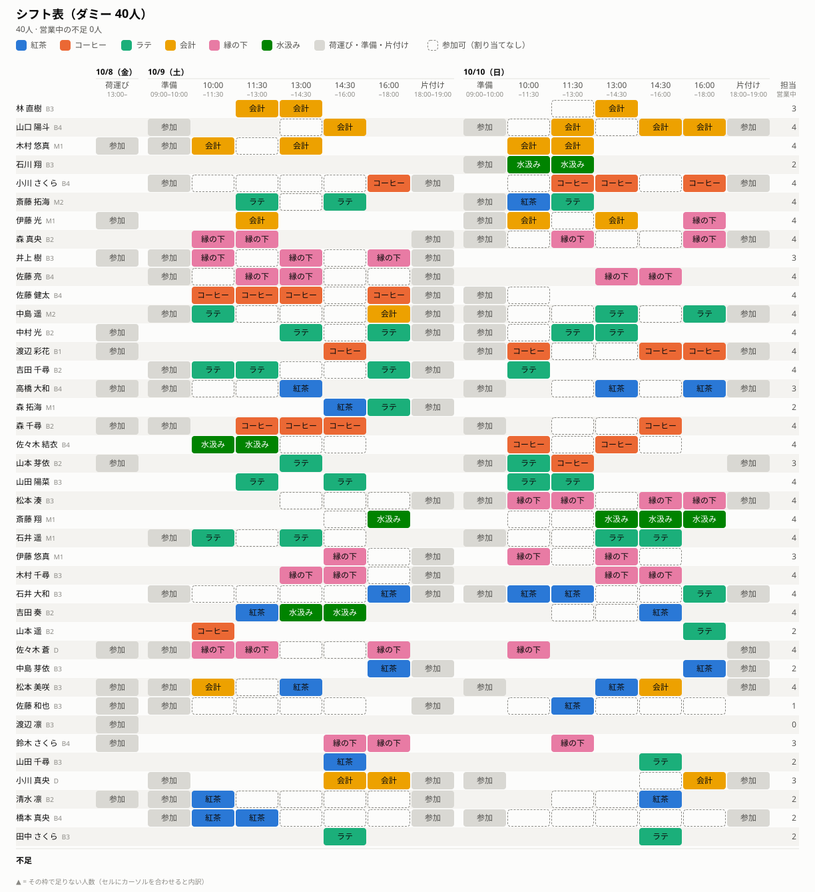

# SchedOpt

English | [日本語](README.ja.md)

Formulates the on-site shift schedule of the university festival café as an integer linear programming (ILP) problem and solves it by mathematical optimization.

## Motivation

Making the café's shift schedule by hand is hard. Each member can come only at certain times, and every service slot needs a set number of people per role.
Some roles need someone who can work them alone, and members have preferred roles. On top of that, the load should be fair and nobody should work too many slots in a row.

This is a variant of the **nurse scheduling problem (NSP)**, also called the **nurse rostering problem (NRP)**.
The NSP asks to assign staff to shifts so that staffing requirements, availability and work rules are met while following preferences as far as possible [1, 2].
It is NP-hard in general [3], and no algorithm is known that finds an optimal schedule efficiently for every input.
Schedules made by hand or by simple rules can therefore easily miss a better schedule, or even one that meets every requirement.

This project therefore finds an optimal schedule with a general-purpose MIP solver.
Using branch and bound, the solver returns an optimal schedule together with a proof that no better one exists. At the size of this café (tens of members, about ten service slots), this takes seconds to minutes.
Even when not every requirement can be met, the model still returns a schedule and reports where people are missing.

## Terms

| Term | Meaning |
|---|---|
| **Raw data** | The Google Form responses, downloaded as CSV |
| **Processed data** | One TSV per event, cleaned from the raw data. Organizers edit it by hand (skill levels, corrections) |
| **Event definition** | `config/<event>/`: the slots and roles of the event. The form is built from it |

## Layout

```
config/<event>/           Event definition, edited by hand (tracked by git)
  slots.csv               Shift slots; labels are the options shown on the form
  roles.csv               Roles; labels are the options shown on the form
data/
  *.csv                   Raw data (contains personal data; not tracked by git)
  processed/<event>.tsv   Processed data (contains names; not tracked by git)
  dummy/small.tsv         Dummy processed data for config/dummy, 40 members
  dummy/medium.tsv        Dummy processed data for config/dummy, 60 members
model/
  schedule.mod            Optimization model (GNU MathProg)
scripts/
  check_processed.awk     Checks processed data against the event definition
  make_dat.awk            Generates the model's data file from the event definition and processed data
  check_assignment.awk    Checks a solved assignment against the processed data
  render_schedule.sh      Draws a solved schedule as an image (SVG; bash + gawk)
  generate_dummy.sh       Dummy data generator (bash + awk)
docs/                     Images for this README (made from dummy data)
out/                      Data files and results (may contain names; not tracked by git)
```

A dataset for the optimizer is `config/<event>/` + `data/processed/<event>.tsv` (or `data/dummy/*.tsv`).

## Setup

Everything runs in a Unix shell; there is nothing to build. On Windows, use WSL.

| Tool | Used for | |
|---|---|---|
| bash | `scripts/*.sh` | required |
| GNU awk (`gawk`) 4.0 or later | every `.awk` script, cleaning the raw data (`FPAT`), drawing the schedule | required |
| GLPK (`glpsol`) | solving the model | required |
| coreutils (`sort`, `cut`, `paste`, …) | cleaning the raw data | required (usually preinstalled) |
| `column` from util-linux | [viewing the processed data](#viewing-the-processed-data) (`-o` needs the util-linux version) | optional |
| Google Chrome | converting the schedule image to PNG | optional |
| another MIP solver | [Other solvers](#other-solvers) | optional |

RHEL / AlmaLinux / Rocky Linux :

```sh
sudo dnf install epel-release
sudo dnf install gawk glpk-utils util-linux
```

Debian / Ubuntu :

```sh
sudo apt install gawk glpk-utils bsdextrautils
```

macOS :

```sh
brew install gawk glpk util-linux
```

Check the setup with the dummy data:

```sh
gawk -f scripts/check_processed.awk config/dummy/roles.csv config/dummy/slots.csv data/dummy/small.tsv   # prints OK
mkdir -p out
gawk -f scripts/make_dat.awk config/dummy/roles.csv config/dummy/slots.csv data/dummy/small.tsv > out/dummy.dat
glpsol -m model/schedule.mod -d out/dummy.dat --cuts
```

`glpsol` should end with a summary in which `missing people` is 0, and write `out/assignment.csv`.
Tested with the commands above on AlmaLinux 10 (gawk 5.3, GLPK 5.0, bash 5.2), Debian 13 and Ubuntu 24.04, and macOS (gawk 5.4.1, GLPK 5.0, util-linux 2.42.4).

## Workflow

1. Define the event in `config/<event>/` ([Event definition](#event-definition))
2. Create the Google Form from that definition ([Creating the form](#creating-the-form))
3. Download the responses as CSV into `data/`
4. Clean them into `data/processed/<event>.tsv` ([Cleaning the raw data](#cleaning-the-raw-data))
5. Fill in skill levels and fix anything needed by hand, then run the check ([Editing the processed data](#editing-the-processed-data))
6. Solve the shift schedule ([Solving](#solving))

## Event definition

UTF-8 CSV with LF line endings.

### slots.csv

```
date,slot,kind,start,end,label
2026-10-09,loading,loading,13:00,,荷運び
2026-10-10,setup,setup,09:00,10:00,朝の準備
2026-10-10,s1,service,10:00,11:30,10:00~11:30
...
2026-10-10,s5,service,16:00,18:00,16:00~18:00
2026-10-10,cleanup,cleanup,18:00,19:00,片付け
2026-10-11,setup,setup,09:00,10:00,朝の準備
...
```

| Column | Content |
|---|---|
| `date` | `YYYY-MM-DD`. Any number of dates is allowed; the form gets one question per date |
| `slot` | Slot ID, unique within the date, no spaces. A slot is identified by (`date`, `slot`) |
| `kind` | `loading` (load-in), `setup` (before the café opens), `service` (café open; needs people per role), `cleanup` (after the café closes). Everyone who answered a `loading` / `setup` / `cleanup` slot works it |
| `start`, `end` | `HH:MM`. `setup` ends when the first `service` slot of the date starts; `cleanup` starts when the last one ends |
| `label` | Option text on the form. Must be unique within the date and must not contain `", "` |

### roles.csv

```
role,label,skill,need
tea,紅茶,1,2
coffee,コーヒー,1,2
latte,ラテ,1,3
cashier,会計,0,2
support,縁の下,0,3
water,水汲み,0,1
```

| Column | Content |
|---|---|
| `role` | Role ID, no spaces or `=` |
| `label` | Option text on the form (unique) |
| `skill` | `1` if organizers rate members' skill level for this role, else `0` |
| `need` | Number of people needed for this role in each `service` slot |

## Creating the form

Create a Google Form with exactly these question titles. The cleaning procedure finds columns by title, so the order does not matter.

| Question title | Type | Options |
|---|---|---|
| `氏名` | Short answer | |
| `学年` | Drop-down | `B1`, `B2`, `B3`, `B4`, `M1`, `M2`, `D` |
| `参加できますか` | Multiple choice | `はい`, `いいえ` |
| `<M/D> 参加できる時間帯` (one per date, e.g. `10/10 参加できる時間帯`) | Checkboxes, not required | `label` of the slots on that date, in file order |
| `第1希望`, `第2希望`, `第3希望` | Drop-down | `label` of every role |
| `備考` | Paragraph | (free text; dropped when cleaning) |

- Turn on **Collect email addresses** (used to keep only the latest response per person).
- Do not add the "Other" option to checkboxes; free text belongs in `備考`.
- Leaving every box of a date unchecked means "not available that day".

## Processed data format

One TSV per event (UTF-8, LF). One row per participant (`参加できますか` = `はい`).

```
member_id  name       grade  pref                    skill                   2027-10-08  2027-10-09      2027-10-10
M001       林 直樹    B3     cashier coffee support  tea=2 coffee=1 latte=2              s2 s3           s2 s3
M003       木村 悠真  M1     cashier support water   tea=1 coffee=2 latte=2  loading     setup s1 s2 s3  s1 s2
```

(rows from `data/dummy/small.tsv`; columns are separated by tabs, aligned here for reading)

| Column | Content |
|---|---|
| `member_id` | `M001`, `M002`, … in submission order |
| `name` | Name as answered |
| `grade` | `B1`–`B4`, `M1`, `M2`, `D` |
| `pref` | Preferred roles (`role` IDs), space-separated, most preferred first. May be empty |
| `skill` | Skill levels set by organizers, `role=level` space-separated. Only roles with `skill=1`. Roles not written are level 0. Empty after cleaning |
| one column per date | `slot` IDs the member can work on that date, space-separated, in `slots.csv` order. Empty = not available |

Skill levels: `0` no experience, `1` can assist, `2` can work the role alone, `3` can teach others.

Dropped from the raw data: timestamp (used only for de-duplication), email address, `参加できますか`, `備考`.
Free-text answers that match no `label` are dropped with a warning.

## Cleaning the raw data

Done by hand in the shell. Example for 2026:

```sh
RAW="data/2026技科大祭当日提供シフトメンバー募集（回答） - フォームの回答 1.csv"
CONF=config/2026
OUT=data/processed/2026.tsv
WORK=data/processed/2026.work          # intermediate files
mkdir -p $WORK
DATES=$(tail -n +2 $CONF/slots.csv | cut -d, -f1 | sort -u | paste -sd' ')   # all dates of the event
```

### 1. CSV → TSV (one response per line)

The exported CSV has CRLF line endings, quoted values containing commas (`"朝の準備, 10:00~11:30"`),
and may have newlines inside free text. gawk's `FPAT` splits the fields, and a line with an unclosed quote is joined with the next one.

```sh
gawk -v FPAT='([^,]*)|("([^"]|"")*")' '
{ sub(/\r$/, "")
  buf = (buf == "" ? $0 : buf " " $0)
  if (gsub(/"/, "&", buf) % 2) next      # unclosed quote -> join with the next line
  $0 = buf; buf = ""
  for (i = 1; i <= NF; i++) {
    f = $i
    if (f ~ /^"/) { f = substr(f, 2, length(f) - 2); gsub(/""/, "\"", f) }
    gsub(/\t/, " ", f)
    printf "%s%s", f, (i < NF ? "\t" : "\n")
  } }' "$RAW" > $WORK/raw.tsv

awk -F'\t' '{ print NF }' $WORK/raw.tsv | sort | uniq -c   # every line should have the same field count
```

### 2. Select columns by question title, drop duplicate submissions, keep participants

```sh
awk -F'\t' -v OFS='\t' -v dates="$DATES" '
NR == 1 {                                   # header: find the columns by title
  for (i = 1; i <= NF; i++) col[$i] = i
  split("タイムスタンプ メールアドレス 参加できますか 氏名 学年 第1希望 第2希望 第3希望", q, " ")
  for (k = 1; k <= 8; k++) q[k] = col[q[k]] ? col[q[k]] : err(q[k])
  n = split(dates, d, " ")
  for (k = 1; k <= n; k++) {                # 2026-10-10 -> "10/10 参加できる時間帯"
    split(d[k], ymd, "-"); title = (ymd[2] + 0) "/" (ymd[3] + 0) " 参加できる時間帯"
    day[k] = col[title] ? col[title] : err(title)
  }
  next }
function err(title) { print "question not found: " title > "/dev/stderr"; exit 1 }
{ split($q[1], t, /[\/ :]/)                 # 2026/09/02 7:59:48 -> 20260902075948 (sortable)
  printf "%04d%02d%02d%02d%02d%02d", t[1], t[2], t[3], t[4], t[5], t[6]
  printf "\t%s", tolower($q[2])
  for (k = 3; k <= 8; k++) printf "\t%s", $q[k]
  for (k = 1; k <= n; k++) printf "\t%s", $day[k]
  print "" }' $WORK/raw.tsv \
| sort -t$'\t' -k1,1r \
| sort -t$'\t' -s -u -k2,2 \
| awk -F'\t' '$3 == "はい"' \
| sort -t$'\t' -k1,1 \
| cut -f4- > $WORK/answers.tsv
```

- `sort -k1,1r` orders newest first; `sort -s -u -k2,2` (stable, unique on email) then keeps only the first, i.e. latest, response per person
- Filter participants **after** de-duplication, so a person whose latest answer is "no" is not kept by an older "yes"
- Finally restore submission order and drop timestamp, email and the join flag

Columns of `answers.tsv`: `name, grade, pref 1, pref 2, pref 3`, then one column per date in `$DATES` order.

### 3. Build the processed data

Role labels are converted with `roles.csv`, slot labels with `slots.csv` (looked up by date and label).
Unknown labels are reported and dropped; repeated preferences keep only the first.

```sh
awk -F'\t' -v OFS='\t' -v dates="$DATES" '
BEGIN { n = split(dates, d, " ") }
FILENAME == ARGV[1] { if (FNR > 1) { split($0, a, ","); role[a[2]] = a[1] } next }     # roles.csv: label -> role
FILENAME == ARGV[2] { if (FNR > 1) { split($0, a, ","); slot[a[1], a[6]] = a[2]       # slots.csv: (date, label) -> slot
                                     order[a[1]] = order[a[1]] " " a[2] } next }
FNR == 1 { printf "member_id\tname\tgrade\tpref\tskill"; for (k = 1; k <= n; k++) printf "\t%s", d[k]; print "" }
{ id = sprintf("M%03d", FNR)
  name = $1; gsub(/^[ 　]+|[ 　]+$/, "", name)
  pref = ""; split("", used)
  for (i = 3; i <= 5; i++) {
    if ($i == "") continue
    if (!($i in role)) { print id ": unknown role: " $i > "/dev/stderr"; continue }
    r = role[$i]; if (!(r in used)) { used[r]; pref = pref (pref == "" ? "" : " ") r }
  }
  printf "%s\t%s\t%s\t%s\t", id, name, $2, pref       # skill is left empty
  for (k = 1; k <= n; k++) {
    split("", chosen); m = split($(5 + k), v, /, /)
    for (j = 1; j <= m; j++)
      if ((d[k], v[j]) in slot) chosen[slot[d[k], v[j]]]
      else if (v[j] != "") print id ": unknown option on " d[k] ": " v[j] > "/dev/stderr"
    out = ""; c = split(order[d[k]], o, " ")            # write slots in slots.csv order
    for (j = 1; j <= c; j++) if (o[j] in chosen) out = out (out == "" ? "" : " ") o[j]
    printf "\t%s", out
  }
  print "" }' $CONF/roles.csv $CONF/slots.csv $WORK/answers.tsv > $WORK/new.tsv
```

### 4. Write the output, keeping skill levels already entered

If `$OUT` already exists (re-running after more responses came in), skill levels are carried over by name,
because `member_id` may change. Other hand edits are not carried over: make them after the form is closed.

```sh
touch $OUT
awk -F'\t' -v OFS='\t' '
FILENAME == ARGV[1] { if (FNR > 1 && $5 != "") skill[$2] = $5; next }
FNR > 1 && $5 == "" && ($2 in skill) { $5 = skill[$2]; delete skill[$2] }
{ print }
END { for (s in skill) print "skill not carried over (name not found): " s > "/dev/stderr" }' \
  $OUT $WORK/new.tsv > $WORK/merged.tsv && mv $WORK/merged.tsv $OUT

gawk -f scripts/check_processed.awk $CONF/roles.csv $CONF/slots.csv $OUT
```

### 5. Clean up

The intermediate files still contain email addresses and free text. Delete them once you have checked the output.

```sh
rm $WORK/raw.tsv $WORK/answers.tsv $WORK/new.tsv && rmdir $WORK
```

### Letting an AI agent do it

The cleaning may also be done by an AI coding agent (e.g. Claude Code) that can run shell commands in this repository.
The raw data contains names and email addresses: use only an AI tool that your organization allows for personal data.

Example prompt:

```
Clean the Google Form responses (raw data) into processed data, following
"Cleaning the raw data" in README.md exactly.

- Raw data: data/<file name>.csv
- Event definition: config/2027/
- Output: data/processed/2027.tsv

Rules:
- Use the commands of the procedure as they are; do not add your own processing.
  If something cannot be handled by the procedure, stop and ask me.
- At the end, run scripts/check_processed.awk and report the result.
- Report every warning (unknown role / unknown option / skill not carried over) as a list.
  Do not interpret free-text answers or reflect them in the data.
- Do not print names, email addresses or other personal data beyond what the report needs.
- After I have confirmed the result, delete the intermediate files with step 5.
```

## Viewing the processed data

The file is plain TSV, so columns do not line up in an editor. Align them for viewing with `column`
(handles empty cells and full-width characters; the file is not changed):

```sh
column -t -s $'\t' data/processed/2026.tsv
column -t -s $'\t' -o ' │ ' data/processed/2026.tsv | less -S     # with separators, scroll sideways
```

A shell alias is handy: `alias tsv="column -t -s $'\t' -o ' │ '"`, then `tsv data/processed/2026.tsv`.

## Editing the processed data

Open `data/processed/<event>.tsv` in an editor or a spreadsheet and edit it directly.
Editor features that align columns by padding cells with spaces (e.g. "align" commands of CSV extensions) must be undone
before processing; the check below reports padded cells.

- Skill levels: write `role=level` in `skill`, e.g. `tea=2 latte=3`
- Availability: add or remove `slot` IDs in the date columns (e.g. for answers like "same as the day before" that were dropped)

Then check it:

```sh
gawk -f scripts/check_processed.awk config/2026/roles.csv config/2026/slots.csv data/processed/2026.tsv
```

It reports unknown grades, roles, slots, skill levels outside 0–3, wrong column counts, duplicate IDs and cells padded with spaces.

## Solving

### Model

`model/schedule.mod` (GNU MathProg) assigns members to roles in the service slots.
Load-in, setup and cleanup slots are worked by everyone who answered them, so they are not optimized.

| Symbol | Meaning |
|---|---|
| $M$, $R$, $R^{skill} \subseteq R$ | members, roles, roles with skill levels |
| $S^{svc}$ | `service` slots |
| $A$ | $(m, t)$ such that member $m$ answered slot $t$ on the form |
| $A^{svc}$ | $(m, t) \in A$ with $t \in S^{svc}$ |
| $n_r$ | people needed per role in a service slot (`roles.csv`) |
| $p_{mr}$ | preference score (`pref_score`): 3 / 2 / 1 for the 1st / 2nd / 3rd preference, else 0 |
| $\ell_{mr}$ | skill level (0–3), only for $r \in R^{skill}$; 0 when not written |
| $\lambda$ | skill level that counts as "can work alone" (`lead_level`, default 2) |
| $k_r$ | people per service slot who can work role $r \in R^{skill}$ alone (`lead_need`, default 1; must be $\le n_r$) |
| $a_m$ | number of service slots member $m$ answered |
| $L$ | fewest service slots per member (`min_load`, default 1) |
| $K$ | most slots in a row (`max_consecutive`, default 3) |

Variables:

- $x_{mtr} \in \{0,1\}$ for $(m, t) \in A^{svc}$, $r \in R$: member $m$ works role $r$ in service slot $t$
- $u_{tr} \ge 0$ for $t \in S^{svc}$, $r \in R$: missing people
- $v_{tr} \ge 0$ for $t \in S^{svc}$, $r \in R^{skill}$: missing can-work-alone people
- $z \ge 0$: service slots of the busiest member
- $y_m \ge 0$ for $a_m > 0$: service slots member $m$ gets below $\min(L, a_m)$

$x$ exists only for $(m, t) \in A^{svc}$, so **nobody is assigned outside the time slots answered on the form**.
$u$, $v$, $y$, $z$ are continuous. Since $x$ is binary and $n_r$, $k_r$, $L$ are integers, $u$ is always an integer, and $v$, $y$, $z$ are integers at every optimum as long as their weights are positive.

In the sums, $t$ runs over $S^{svc}$; in a sum where $m$ is fixed, only over $t$ with $(m, t) \in A^{svc}$. $m$ runs over members with $(m, t) \in A$.

$$
\min\ w^{short} \sum_{t,r} u_{tr} + w^{lead} \sum_{t,\ r \in R^{skill}} v_{tr} - w^{pref} \sum_{m,t,r} p_{mr}\, x_{mtr} + w^{fair}\, z + w^{under} \sum_m y_m
$$

| Weight | Parameter | Default | Per |
|---|---|---|---|
| $w^{short}$ | `w_short` | 1000 | missing person |
| $w^{lead}$ | `w_lead` | 100 | missing can-work-alone person |
| $w^{pref}$ | `w_pref` | 1 | preference score point |
| $w^{fair}$ | `w_fair` | 10 | service slot of the busiest member |
| $w^{under}$ | `w_under` | 50 | service slot a member gets below `min_load` |

Weights are assumed to be non-negative.

| Constraint | |
|---|---|
| $\sum_r x_{mtr} \le 1 \quad ((m, t) \in A^{svc})$ | one role at a time |
| $\sum_m x_{mtr} + u_{tr} = n_r \quad (t \in S^{svc},\ r \in R)$ | people per role in each service slot |
| $\sum_{m:\ \ell_{mr} \ge \lambda} x_{mtr} + v_{tr} \ge k_r \quad (t \in S^{svc},\ r \in R^{skill})$ | at least $k_r$ people who can work the role alone |
| $\sum_{t,r} x_{mtr} \le z \quad (m \in M)$ | service slots of every member are at most $z$ |
| $\sum_{t,r} x_{mtr} + y_m \ge \min(L, a_m) \quad (a_m > 0)$ | everyone who answered a service slot works at least $\min(L, a_m)$ of them (soft: each slot short is penalized) |
| $\sum_{t \in W} b_{mt} \le K$ for every member $m$ and every run $W$ of $K+1$ slots in a row that contains a service slot | at most $K$ slots in a row |

In the last row, $b_{mt}$ is whether member $m$ works slot $t$: $b_{mt} = \sum_r x_{mtr}$ for a service slot the member answered, $b_{mt} = 1$ for a load-in / setup / cleanup slot the member answered
(they work it), and $b_{mt} = 0$ for a slot the member did not answer. Slots are "in a row" when they are next to each other in `slots.csv` on the same date.
Runs without a service slot are left out: their sum is a constant that the model cannot change, and if it exceeded $K$ the model would have no solution.

Missing people are allowed at a high cost, so the model always has a solution and reports where people are missing.
Leaving a member below `min_load` is also allowed (it can be unavoidable when there are more members than seats).
With the default weights, the model normally gives priority in this order: missing people, missing can-work-alone people, members below `min_load`, then preferences and fairness.
This order comes from the ratios of the weights and is not strictly guaranteed: for example, since `w_lead` is exactly twice `w_under`, one missing can-work-alone person and two members below `min_load` cost the same.
To make the order stricter, widen the gaps (e.g. `w_lead` more than twice `w_under`).
Weights (`w_short`, `w_lead`, `w_pref`, `w_fair`, `w_under`), preference scores (`pref_score`), the level that counts as "can work alone" (`lead_level`),
the number of such people (`lead_need`), the most slots in a row (`max_consecutive`) and the fewest service slots per member (`min_load`) are parameters with defaults; override them in an extra data file:

```
data;
param w_fair := 30;
param lead_need := latte 2;
param max_consecutive := 2;
end;
```

### Running

```sh
mkdir -p out
gawk -f scripts/make_dat.awk config/2026/roles.csv config/2026/slots.csv data/processed/2026.tsv > out/2026.dat
glpsol -m model/schedule.mod -d out/2026.dat --cuts     # add  -d weights.dat  to override parameters
gawk -v max_consecutive=3 -f scripts/check_assignment.awk config/2026/slots.csv data/processed/2026.tsv out/assignment.csv
```

`--cuts` turns on GLPK's cutting planes; without it, some data sets (2026) find the optimum quickly but take minutes to prove it.
`glpsol` prints the assignment per slot and a summary (missing people, busiest member, members with no service slot, preferences met),
and writes `out/assignment.csv` (`member_id,name,date,slot,role`; `role` is empty for load-in / setup / cleanup).
`check_assignment.awk` confirms that every assignment is in a slot the member answered, nobody is assigned twice to one slot,
and nobody works more than `max_consecutive` slots in a row (give the same value as the model); it also prints the longest run.

### Schedule image

Draw the result as an image: one row per member, one column per slot, the role written in each cell.

```sh
scripts/render_schedule.sh --config config/2026 --processed data/processed/2026.tsv \
  --assignment out/assignment.csv -o out/schedule.svg --title "シフト表 2026"
```

Open `out/schedule.svg` in a browser (hovering a cell shows its details). For a PNG, let Chrome take a screenshot;
the size is printed in the SVG's `width` / `height`:

```sh
google-chrome --headless=new --hide-scrollbars --window-size=1224,1338 \
  --screenshot=out/schedule.png "file://$PWD/out/schedule.svg"
```

Example with `data/dummy/small.tsv`:



Cells: role (colored, with its name) · `参加` for load-in / setup / cleanup · dashed outline = available but not assigned ·
empty = not available. The right column counts service slots per member; the bottom row marks missing people with ▲.

### Other solvers

To use another MIP solver (HiGHS, SCIP, CPLEX, Gurobi, …), write the model in LP format and give it to that solver:

```sh
glpsol -m model/schedule.mod -d out/2026.dat --check --wlp out/2026.lp
```

## Dummy data

`scripts/generate_dummy.sh` generates processed data for any event definition (bash + awk only).
The dates, slots and roles come from the config.

```sh
scripts/generate_dummy.sh --config config/dummy -o data/dummy/small.tsv -n 40  --seed 0
scripts/generate_dummy.sh --config config/dummy -o data/dummy/medium.tsv -n 60 --seed 1
```

It prints the number of service seats (service slots × people needed per slot) and of members who can work a service slot,
and warns when there are more members than seats: then someone gets no service slot and the solver slows down.

The same command with the same `--seed` gives the same data again, as long as the script and the awk implementation are the same.
The commands above show how the files in `data/dummy/` were made, but those files are not guaranteed to match what the current script generates
(the script may have changed since, or the files may have been edited); `data/dummy/small.tsv` currently does not.

Names are random combinations of common Japanese family and given names.

For each date, a member is available for:

- each `loading` slot with probability 45%
- every slot of the date (18%), none (12%), or a contiguous block of `service` slots, occasionally with one slot missing in the middle.
  A block starting at the first service slot tends to include `setup`; one ending at the last service slot tends to include `cleanup`

A date with the same slot kinds as the previous one copies its pattern with probability 35%.

Skill levels are drawn for every role with `skill=1`, higher for senior grades and often one level higher for the first preference.

## Quick stats

```sh
F=data/dummy/small.tsv

# Long format: one line per (member, date, slot)
awk -F'\t' -v OFS='\t' 'NR == 1 { for (i = 6; i <= NF; i++) h[i] = $i; next }
  { for (i = 6; i <= NF; i++) { m = split($i, v, " "); for (j = 1; j <= m; j++) print $1, h[i], v[j] } }' $F > long.tsv

# Number of available members per slot
cut -f2,3 long.tsv | sort | uniq -c

# Distribution of available slots per member (how many members can work N slots)
cut -f1 long.tsv | uniq -c | awk '{ print $1 }' | sort -n | uniq -c

# Breakdown of first preferences
tail -n +2 $F | cut -f4 | cut -d' ' -f1 | sort | uniq -c | sort -rn

# Members who can make lattes alone (level 2 or more)
awk -F'\t' 'NR > 1 && $5 ~ /(^| )latte=[23]/ { print $1, $2, $5 }' $F
```

## References

1. Wikipedia, "Nurse scheduling problem" (revision of 16 August 2026). <https://en.wikipedia.org/w/index.php?title=Nurse_scheduling_problem&oldid=1369652809>
2. E. K. Burke, P. De Causmaecker, G. Vanden Berghe, H. Van Landeghem. The state of the art of nurse rostering. *Journal of Scheduling* 7(6): 441–499, 2004. [doi:10.1023/B:JOSH.0000046076.75950.0b](https://doi.org/10.1023/B:JOSH.0000046076.75950.0b)
3. T. Osogami, H. Imai. Classification of various neighborhood operations for the nurse scheduling problem. In *Algorithms and Computation (ISAAC 2000)*, LNCS 1969, pp. 72–83, Springer, 2000. [doi:10.1007/3-540-40996-3_7](https://doi.org/10.1007/3-540-40996-3_7)
